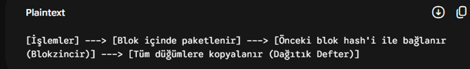

                                 İP 01: Blokzincir ve Ortak Kayıt
1. Blokzincir, işlem, blok ve dağıtık defter nedir? Birbirleriyle nasıl ilişkilidir? 
•	İşlem (Transaction): Ağ üzerinde durum değişikliği yaratan en küçük veri birimidir (örneğin bir varlık transferi veya bir akıllı sözleşmeye kayıt ekleme talebi).
•	Blok (Block): Belirli bir sürede ağa gelen doğrulanmış işlemlerin bir araya getirilip paketlendiği veri yapısıdır. Her blok, kendi verilerinin yanında bir önceki bloğun kriptografik özetini (hash) de taşır.
•	Blokzincir (Blockchain): Blokların birbirine önceki bloğun hash değeri üzerinden kronolojik olarak bağlanmasıyla oluşan, geriye dönük değiştirilemeyen veri zinciridir.
•	Dağıtık Defter (Distributed Ledger): Bu blokzincirin tek bir merkezde değil, ağdaki birbirinden bağımsız çok sayıda düğümde (node) eş zamanlı olarak saklanması ve senkronize edilmesidir.
•	İlişki Akışı:
 

2. Merkezi veritabanıyla blokzincir arasında kayıt kontrolü ve güven açısından ne fark vardır? 
•	Kayıt Kontrolü: Merkezi veritabanlarında (MS SQL, PostgreSQL vb.) yetkili yönetici (admin) tüm CRUD (ekle, oku, güncelle, sil) yetkilerine sahiptir; geçmiş kayıtları değiştirebilir veya silebilir. Blokzincir ise yalnızca ekleme yapılabilen (append-only) bir yapıdadır; onaylanmış geçmiş kayıtlar tek bir otorite tarafından silinemez veya değiştirilemez.
•	Güven Modeli: Merkezi sistemlerde güven, sistemi işleten kuruma ve yöneticilerin dürüstlüğüne/güvenliğine dayanır. Blokzincirde ise güven tek bir kuruma değil; kriptografiye, açık kurallara ve ağın uzlaşma (konsensüs) mekanizmasına dayanır.
3. Geçmiş işlemin kaydı ile sözleşmede tutulan güncel değerin değişmesi nasıl ayrılır? 
•	Geçmiş İşlem Kaydı (Transaction History): Zincire yazılan her işlem kalıcı bir tarihçe olarak saklanır. Örneğin "X adresi saat 14:00'te durumu 'aktif' yaptı" kaydı asla silinmez.
•	Güncel Değer (Current State): Sözleşmenin o anki son durumudur. Yeni bir işlemle bu değer 'pasif' olarak güncellenebilir. Yani güncel state değişir, ancak o değişikliğe yol açan eski ve yeni işlemlerin tamamı zincir geçmişinde ayrı ayrı durmaya devam eder.
4. Bir etkinlik kayıt sisteminde blokzincir kullanmanın yararı ve ek maliyeti ne olabilir? 
•	Yararları: Kayıtlar şeffaf ve herkes tarafından doğrulanabilir olur; organizatör veya dışarıdan bir müdahale ile sonradan gizlice kayıt silinemez, kapasite kuralları manipüle edilemez.
•	Ek Maliyetleri: Her kayıt işlemi için ağa işlem ücreti (gas fee) ödenmesi gerekir. İşlemlerin bloklara alınıp onaylanması geleneksel veritabanlarına göre daha yavaştır ve kullanıcıların cüzdan kullanmayı bilmesi gerektiği için kullanım eşiği yükselir.
Benim Yorumum: Hangi durumda normal veritabanını tercih ederdiniz? Tüm tarafların tek bir kuruma güvendiği, yüksek işlem hızı (saniyede binlerce okuma/yazma) gereken, kullanıcıların işlem ücreti ödemesinin mantıksız olduğu ve KVKK/GDPR kapsamında verilerin gerektiğinde silinmesinin şart olduğu senaryolarda normal veritabanını tercih ederim. Çünkü güven problemi olmayan bir yerde dağıtık mutabakat kullanmak sadece gereksiz maliyet ve yavaşlık getirir.

5. EK NOTLAR
 CIA Üçlüsü Tuzağı (Gizlilik Yoktur!): Blokzincir denince çoğu kişi "şifreli ve gizli" sanır. Yanlış. Public blokzincirler Confidentiality (Gizlilik) sağlamaz; aksine her şey şeffaf ve herkese açıktır. Blokzincirin asıl çözdüğü iki ayak Integrity (Bütünlük) ve Availability (Erişilebilirlik) taraflarıdır.
 Anti-Forensics ve Log Tampering Analojisi: Bir saldırgan sisteme sızdığında ilk yaptığı şeylerden biri izini silmek için Windows Event Log'ları veya /var/log kayıtlarını temizlemektir. Blokzincir, teorik olarak değiştirilemeyen (immutable) ve tek bir noktadan silinemeyen dağıtık bir audit log / SIEM gibi çalışır.
Hash Zinciri = Ağ Çapında FIM (File Integrity Monitoring): Her bloğun içinde bir önceki bloğun hash'inin bulunması, sistemdeki kritik dosyaların hash'ini takip eden FIM araçlarıyla aynı mantıktır. Geçmişteki tek bir işlemde 1 bitlik değişiklik yapıldığında, o bloğun ve sonrasındaki tüm blokların hash'i bozulur; ağdaki diğer düğümler bu manipülasyonu anında reddeder.
Saldırı Yüzeyi Değişir, Yok Olmaz: Blokzincir kullanmak sistemi "hacklenemez" yapmaz. Saldırgan artık SQL Injection ile veritabanını silemez ama odağını şu üç yere kaydırır:
1.	Smart Contract Zafiyetleri: Kod mantığındaki hatalar (yetki kontrolü eksikliği, reentrancy vb.).
2.	Endpoint / Cüzdan Güvenliği: Kullanıcının private key'ini veya seed'ini çalan Infostealer zararlıları ve Phishing (oltalama) saldırıları.
3.	Garbage In, Garbage Out: Zincir, verinin yazıldıktan sonra değiştirilmediğini garanti eder; baştan sisteme yanlış veya sahte veri girilmesini tek başına engellemez.

