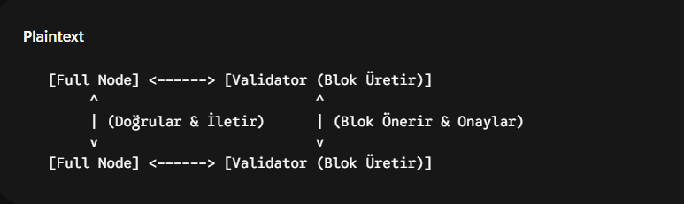
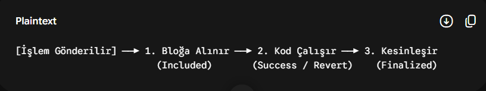

     İP-02:Node ve Konsensüs
1. Node (Düğüm) ve Validator (Doğrulayıcı) Farkı
Blokzincirde tek bir merkez sunucu yoktur; ağ, birbirine P2P (eşten eşe) bağlı binlerce bilgisayardan oluşur.

Node (Düğüm): Blokzincir yazılımını çalıştıran, defterin kopyasını tutan ve gelen işlemleri kurallara göre kontrol eden herhangi bir bilgisayardır.

Validator (Doğrulayıcı): Sadece izlemekle kalmayıp yeni blok üretme ve onaylama yetkisine sahip özel düğümlerdir.

Kritik kural: Her validator bir node'dur, ama her node blok üretmez. Ağdaki normal düğümler (Full Node) sadece gelen blokları bağımsız olarak denetler ve uygulamalara veri sağlar.

2. Konsensüs (Uzlaşma): PoW vs. PoS
Ortada bir admin veya merkez sunucu yoksa, ağdaki 10.000 bilgisayar "Hangi işlem geçerli, kimin kaç parası var?" konusunda nasıl anlaşacak? İşte bunu sağlayan kurallar bütününe Konsensüs denir.

PoW (Proof of Work – İş Kanıtı): "En çok işlem gücü ve elektrik harcayıp kriptografik bulmacayı ilk çözen yeni bloğu yazar." (Örn: Bitcoin).

PoS (Proof of Stake – Hisse Kanıtı): "Ağa teminat (stake) olarak kripto para kilitleyenler arasından kurallara göre seçilen kişi yeni bloğu yazar. Hile yaparsa kilitlediği para ceza olarak yakılır (slashing)." (Örn: Ethereum).

 Not: PoW ve PoS sadece "kim blok yazacak" kurası değildir; ikisi de Sybil Saldırısını (bir saldırganın tek bilgisayardan 100.000 sahte düğüm açıp oylamayı ele geçirmesini) engellemek için kurulmuş ekonomik kalkanlardır. Bedava sahte düğüm açamazsın; ya donanım/elektrik (PoW) ya da para (PoS) yakmak zorundasın.

 3. Ağ Türleri: Public/Private ve Permissionless/Permissioned
Bu iki kavram genelde karıştırılır ama ağın iki farklı özelliğini anlatır:

Public / Private (Görünürlük): Defteri dışarıdan herkes okuyabiliyor mu, yoksa sadece kurum içi mi?

Permissionless / Permissioned (Yetki): Ağa katılmak, işlem göndermek veya doğrulayıcı olmak için bir otoriteden izin gerekiyor mu?

İzinleri 3 katmanda ayırırsın:  

Okuma (Read): Verileri görme.İşlem Gönderme

(Write): Ağa yeni veri/transfer yazma.Doğrulayıcı Olma 

(Validate): Blok üretme ve onaylama.

Ethereum gibi ağlar Public & Permissionless'tır (herkes okur, herkes yazar, şartı sağlayan herkes doğrulayıcı olur). Bankaların kendi aralarında kurduğu ağlar ise Private & Permissioned'dır (izin olmadan okuyamazsın bile).

4. Bir İşlemin 3 Aşaması: Bloğa Alınma → Çalışma → Kesinleşme

Bir işlemi gönderdiğinde hemen "bitti" sayılmaz; 3 ayrı filtreden geçer:

Bloğa Alınma (Inclusion): Doğrulayıcı senin işlemini alıp bir bloğun içine koyar.

Başarılı Çalışması (Execution): Blok içindeki işlem sanal makinede (EVM) çalışır. Dikkat: Bir işlem bloğa alınmış ama başarısız (reverted) olmuş olabilir (örneğin etkinlik kapasitesi doluyken kayıt denedin). İşlem başarısız olsa bile ağ kaynak harcadığı için gas ücreti yine kesilir.

Kesinleşme (Finality): Bloğun üzerine yeni bloklar eklendikçe artık geri döndürülemez (reorg/çatallanma ile silinemez) hale gelmesidir.

5. Tek Bir Node Kapanırsa Ağ Durur mu?
Bu tamamen Single Point of Failure (SPOF – Tekil Hata Noktası) ve konsensüs eşiğine bağlıdır.

Binlerce bağımsız düğümü olan dağıtık bir ağda tek bir node kapanırsa hiçbir şey olmaz, ağ çalışmaya devam eder (yüksek Availability).

Ama tek bir doğrulayıcıya bağlı özel bir ağda veya doğrulayıcıların büyük çoğunluğunun aynı bulut sunucusunda (örneğin tek bir AWS bölgesinde) barındırıldığı bir yapıda o kritik düğüm düşerse, konsensüs için gereken çevrimiçi oy oranı sağlanamaz ve tüm ağ kilitlenir.

Benim Yorumum: Tek bir node kapanınca bütün ağın durup durmayacağı neye bağlıdır?
Bu durum ağın merkeziyetsizlik derecesine, tekil hata noktası (SPOF) barındırıp barındırmadığına ve konsensüs eşiğine bağlıdır. Binlerce bağımsız düğümden oluşan public bir ağda tek bir node'un kapanması ağı etkilemez. Ancak tek bir doğrulayıcıya bağlı özel bir ağda veya doğrulayıcıların çoğunluğunun aynı sunucu/altyapıda toplandığı bir sistemde kritik bir düğümün kapanması konsensüs için gereken minimum çevrimiçi oranını bozacağı için tüm ağı durdurabilir.