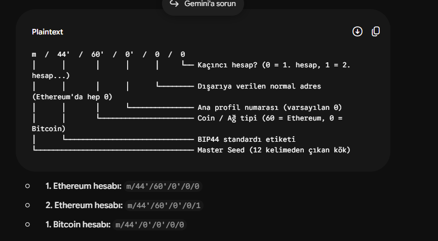
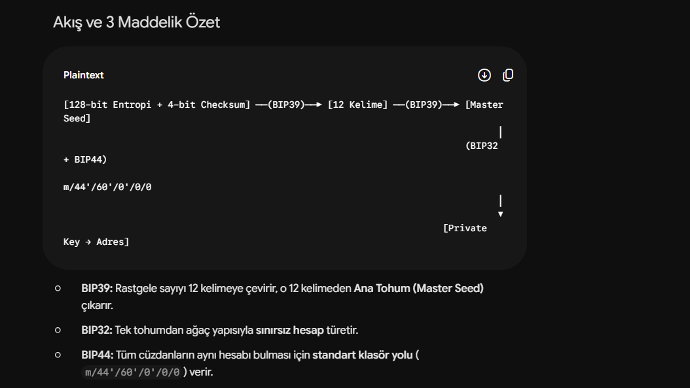

BIP39, BIP32 ve BIP44 — Hızlı Hatırlatma Notu

Cüzdanların hem insan tarafından yedeklenebilmesi hem de tüm cüzdan uygulamalarında (MetaMask, Trust Wallet, Ledger vb.) birebir aynı hesapları açabilmesi için birlikte çalışan üç standarttır (BIP = Bitcoin Improvement Proposal).

1. BIP39 — 12 Kelimelik Ana Yedek (Mnemonic → Seed)
Ne işe yarar? Bilgisayarın ürettiği 128 bitlik rastgele entropi + 4 bitlik hata kontrol kodunu (checksum, toplam 132 bit), insanın kağıda yazıp saklayabileceği 12 İngilizce kelimeye (Mnemonic) çevirir.

Nasıl çalışır? 132 bit, 11'er bitlik 12 parçaya bölünür. Her parça, 2048 kelimelik sabit sözlükten bir kelimeye denk gelir.

Geri dönüşüm: Bu 12 kelime cüzdana girildiğinde BIP39 bunları her seferinde aynı sonucu verecek şekilde (deterministik) 512 bitlik Master Seed (Ana Tohum) verisine dönüştürür.

2. BIP32 — Tek Yedekten Sınırsız Hesap (HD Wallet)
Ne işe yarar? Her yeni hesap için ayrı yedek alma derdini bitirir. Hiyerarşik Deterministik (HD) yapı kurar.

Nasıl çalışır? BIP39'dan çıkan tek bir Master Seed kökünden ağaç gibi dallanarak sınırsız sayıda Private Key / Public Key çifti türetir.

Pratikte: MetaMask'te "Hesap Ekle" dediğinde yeni 12 kelime vermeden 2. ve 3. hesabı açmasını sağlayan sistem BIP32'dir; tüm hesaplar o tek 12 kelimeye bağlıdır.

3. BIP44 — Ortak Klasör / Oda Numarası Standardı (Derivation Path)
Ne işe yarar? BIP32 sınırsız hesap üretir ama hangi uygulamanın hangi hesabı nerede arayacağını belirlemez. BIP44, aynı 12 kelimeyi farklı cüzdan uygulamalarına girdiğinde birebir aynı adreslerin aynı sırada çıkması için standart klasör yolunu tanımlar.

