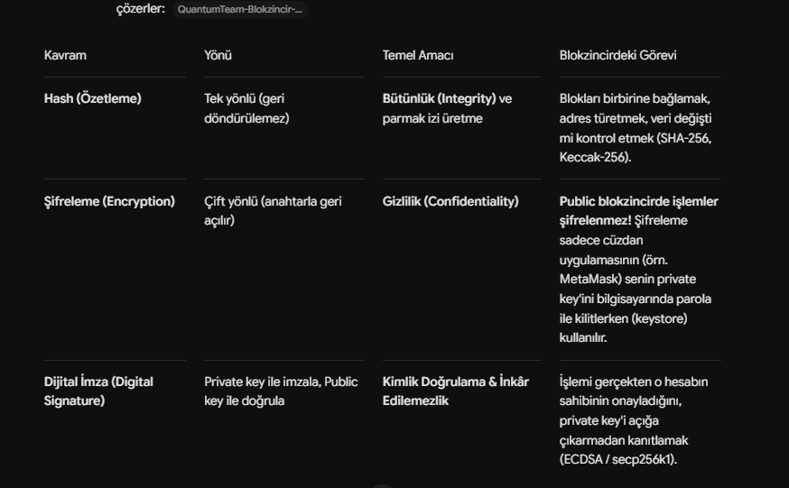
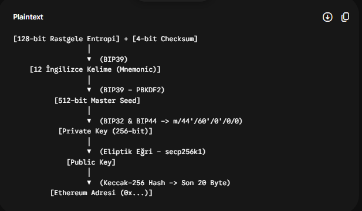

İP 03: Kriptografi ve Cüzdan

 Not: Bir işlemi "şifreleyip" göndermiyorsun, imzalayıp gönderiyorsun. Ağdaki herkes işlemin içeriğini açıkça okur; senin imzan sadece "Bu transferi gerçekten bu adresin sahibi onayladı ve yolda kimse değiştirmedi" kanıtıdır.

2. Entropiden Ethereum Adresine Giden Yol (BIP39, BIP32, BIP44)
Bir cüzdan oluşturulduğunda arka planda tek yönlü çalışan bir üretim hattı vardır (İP 12'de tam olarak bunu kodlayacağız orada daha detaylı işleyeceğiz oraya bak):

Entropi (Rastgelelik): Güvenliğin sıfır noktasıdır. Tahmin edilemez, kriptografik olarak güvenli rastgele bitlerdir 
(örneğin 12 kelime için 128 bit). Entropi zayıfsa (örneğin Math.random() kullanılırsa) saldırgan aynı cüzdanı tahmin edip üretebilir.  

 Checksum (Sağlama Toplamı): Entropinin SHA-256 özetinin ilk birkaç biti alınır ve entropinin sonuna eklenir. Görevi, 12 kelimeyi bir yere yazarken veya cüzdana girerken yaptığın yazım/sıra hatalarını yakalamaktır. 
 
BIP39: Rastgele entropi + checksum verisini insanın okuyup saklayabileceği 12/24 İngilizce kelimeye (Mnemonic) ve bu kelimeleri kriptografik Seed'e dönüştüren standarttır. 
   
 BIP32 (HD Wallet): Tek bir Master Seed'den ağaç (hiyerarşik) yapısında sınırsız sayıda Private Key / Public Key çifti türetilmesini sağlayan standarttır.   
     
 BIP44: BIP32 ağacındaki standart klasörleme/yo(derivation path) kuralıdır. Ethereum için standart yol m/44'/60'/0'/0/0 şeklindedir (60 Ethereum'u temsil eder). Böylece aynı 12 kelimeyi farklı cüzdan uygulamalarına girdiğinde hep aynı adres çıkar. 
     
 Private Key → Public Key → Adres: Bu dönüşüm tamamen tek yönlüdür. Private key'den adresini saniyeler içinde bulursun ama adresten geriye gidip private key'i matematiksel olarak çözemezsin.

 3. Cüzdan Uygulaması, Hesap ve Paylaşım RiskleriCüzdan Uygulaması ≠ Hesap: MetaMask, Trust Wallet veya donanım cüzdanları parayı içinde saklayan bir kasa değildir. Varlıkların ve kayıtların her zaman blokzincirin üzerinde durur. Cüzdan uygulaması sadece senin anahtarlarını tutan ve zincirle iletişim kuran bir arayüzdür (e-posta hesabın ile Gmail uygulaması arasındaki fark gibi).   Adresi Paylaşmak vs. Anahtarı Paylaşmak:Adres (0x...): Banka IBAN'ı gibidir. Ödeme almak veya kimlik/kayıt doğrulamak için paylaşılır; tek başına harcama yetkisi vermez. 
 
  Private Key / Mnemonic: Hesabın mutlak mülkiyetidir. Bunu ele geçiren kişi (veya bir infostealer zararlısı) saniyeler içinde tüm varlıkları boşaltabilir ve senin adına işlem imzalayabilir.   
 
 Adres Paylaşımının Mahremiyet Etkisi: Public blokzincirler "anonim" değil, takma adlıdır (pseudonymous). Adresini bir yerde gerçek ad-soyadınla ilişkilendirdiğin an (örneğin bir etkinlik kaydında veya borsada), o adresin tüm geçmiş ve gelecek transferleri, bakiyesi ve kullandığı uygulamalar herkes tarafından açıkça izlenebilir (zincir üstü OSINT / analiz).  

 4.  Uygulamanın Silinmesi vs. Kurtarma Bilgisinin Kaybolması
 Cüzdan uygulamasının silinmesi, telefonun kırılması veya bilgisayarın formatlanması hesabın kaybolması anlamına gelmez. Çünkü varlıklar cihazda değil blokzincirdedir. Elinde 12 kelimelik kurtarma ifadesi (mnemonic) duruyorsa, başka bir cihaza herhangi bir uyumlu cüzdan uygulaması kurup kelimeleri girdiğinde tüm hesapların ve bakiyen birebir geri gelir.   Buna karşılık kurtarma bilgisinin (mnemonic / private key) kaybolması geri dönüşü olmayan kalıcı bir kayıptır. Merkeziyetsiz yapılarda "şifremi unuttum" diyebileceğin bir müşteri hizmetleri, yönetici veya kimlik doğrulama sistemi yoktur. Anahtarı kaybeden kişi, zincirdeki varlıkları sonsuza kadar kilitli bırakmış olur