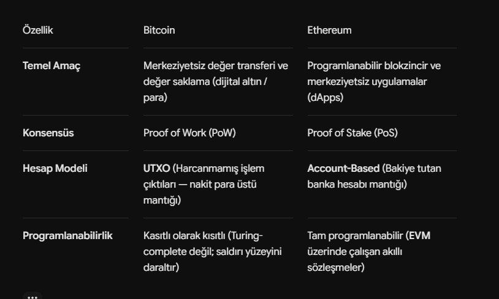
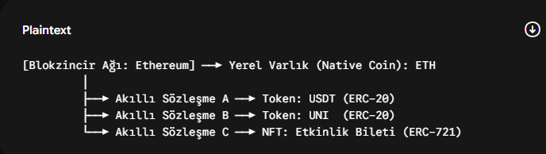

İP 04: Bitcoin, Ethereum ve Token

1. Bitcoin ve Ethereum Neden Farklıdır?
İkisi de public ve permissionless blokzincir ağlarıdır ama farklı problemleri çözmek için tasarlanmışlardır:

UTXO vs. Account Farkı: Bitcoin'de cüzdan bakiyen aslında sana gelmiş ve henüz harcamadığın eski transfer parçalarının toplamıdır (cebindeki 50 TL ve 20 TL banknotlar gibi). Ethereum'da ise her adresin doğrudan güncel bir bakiye ve durum (state) kaydı tutulur.

2. Coin (Yerel Varlık) ve Token Arasındaki Fark
Günlük dilde hepsine "coin" dense de teknik olarak tamamen farklı katmanlardadırlar:

Native Coin (Yerel Varlık): Kendi bağımsız blokzincirine sahip varlıktır (Bitcoin ağında BTC, Ethereum ağında ETH, Solana ağında SOL). Ağın güvenliğini sağlamak (madencilik/staking) ve işlem ücretlerini (gas) ödemek için protokol seviyesinde zorunludur.

Token: Kendi blokzinciri yoktur. Ethereum gibi mevcut bir ağın üzerine konuşlandırılmış bir akıllı sözleşme içinde tanımlanan dijital varlıktır (örneğin USDT, USDC, LINK). Token bakiyeleri aslında o akıllı sözleşmenin içindeki bir defterde (adres -> miktar tablosu) tutulur.

3. EVM, Akıllı Sözleşme ve Gas Mantığı
Ethereum'u sadece para transferi yapan bir ağ olmaktan çıkarıp programlanabilir hale getiren üçlü yapı şudur:

Akıllı Sözleşme (Smart Contract): Blokzincire yüklenen ve belirli koşullar sağlandığında aracıya gerek kalmadan otomatik çalışan kodlardır (genellikle Solidity ile yazılır). Kendi adresi vardır ve dışarıdan çağrıldığında kuralları birebir uygular.

EVM (Ethereum Virtual Machine): Akıllı sözleşmeleri ağdaki tüm düğümlerde izole (sandbox) ve deterministik (her makinede aynı girdiye birebir aynı çıktıyı verecek şekilde) çalıştıran sanal makinedir.

Gas (İşlem Ücreti): EVM üzerinde çalıştırılan her bir işlem adımının (toplama, veri depolama, transfer) hesaplama birimidir ve ağın yerel coin'i (ETH) ile ödenir.

 Not (Gas Neden Var?): Gas sadece doğrulayıcılara ödenen bir komisyon değildir; doğrudan bir DoS (Hizmet Engelleme) savunmasıdır. Ethereum programlanabilir olduğu için bir saldırgan ağa while(true) gibi sonsuz döngü içeren bir akıllı sözleşme atıp tüm düğümleri kilitleyebilirdi. Gas limiti sayesinde her işlem adımının bir maliyeti vardır; ayrılan gas bittiği an EVM işlemi keser (Out of Gas) ve ağ kilitlenmez.

 4. Temel Ethereum Token Standartları (ERC)
ERC (Ethereum Request for Comment), token sözleşmelerinin tüm cüzdanlar ve borsalarla sorunsuz çalışması için uyması gereken ortak fonksiyon arayüzleridir (örneğin transfer(), balanceOf()):

ERC-20 (Fungible — Değiştirilebilir Token): Birbirinin birebir aynısı olan ve bölünebilen varlıklar içindir. Senin elindeki 1 USDT ile başkasının elindeki 1 USDT tamamen aynı değerdedir (stablecoin'ler, yönetişim tokenları).

ERC-721 (NFT — Non-Fungible Token): Her bir parçanın benzersiz bir kimlik numarasına (tokenId) sahip olduğu, bölünemeyen varlıklar içindir. Dijital sertifikalar, etkinlik biletleri, üyelik kartları veya sahiplik kayıtları için kullanılır.

ERC-1155 (Multi-Token): Tek bir akıllı sözleşme içinde hem değiştirilebilir (ERC-20 benzeri) hem de benzersiz (ERC-721 benzeri) varlıkları toplu şekilde yönetebilen hibrit standarttır. Özellikle oyun ekonomilerinde (1000 adet altın + 1 adet eşsiz eşya) ve toplu transferlerde gas tasarrufu sağlar.

5. Yorumum: Cüzdanımda Token Varken Neden İşlem İçin ETH Gerekir?
Bir kullanıcının cüzdanında 500 USDT (ERC-20 token) bulunmasına rağmen, cüzdanda hiç ETH yoksa o USDT'yi başka bir adrese gönderemez. Çünkü USDT transferi aslında USDT akıllı sözleşmesindeki transfer() fonksiyonunu çağırıp zincirdeki durumu güncellemektir. Bu kodu EVM üzerinde çalıştıran ve bloğa ekleyen doğrulayıcılar, harcadıkları işlem gücü karşılığında ücreti (gas) token cinsinden değil, ağın kendi yerel varlığı olan ETH cinsinden tahsil eder.