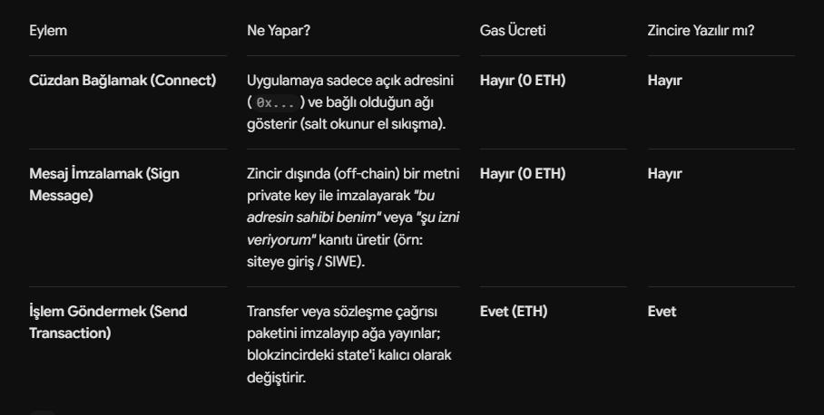
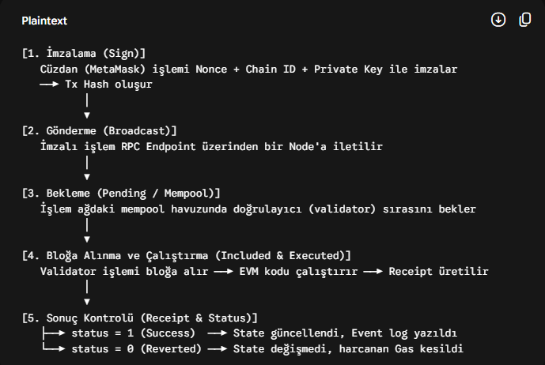

                    İP 07: Bir İşlemin Yolculuğu

Web3 uygulamalarında MetaMask penceresi üç farklı amaçla açılır; bunların güvenlik ve maliyet etkileri tamamen farklıdır:

 

 Not: "Mesaj imzalamak bedava ve zincire yazılmıyor, o yüzden zararsızdır" düşüncesi büyük bir tuzaktır. Phishing siteleri, gas gerektirmeyen özel imzalarla (EIP-2612 Permit veya Seaport/NFT onayları) senden tokenlarını çekme yetkisi alabilir. Ekranda ne imzaladığını okumadan asla onay vermemek gerekir.

 2. Gas Limit, Gas Used, İşlem Ücreti, Nonce ve Chain ID
Bir işlem paketi oluşturulurken ağın güvenliği ve hesaplaması için 5 temel alan kullanılır:

Gas Limit: İşlemin harcamasına izin verdiğin maksimum hesaplama birimi (tavan sınır). Standart bir ETH transferi her zaman 21.000 gas limit ister; akıllı sözleşme çağrıları daha yüksek limit gerektirir.

Gas Used: İşlem EVM üzerinde çalıştırılırken gerçekte harcanan gas miktarıdır. Gas Used, belirlediğin Gas Limit'ten küçükse kullanılmayan kısım iade edilir. Yetmezse işlem Out of Gas hatasıyla iptal (revert) olur ama harcanan gas yanar.

İşlem Ücreti (Transaction Fee): Harcanan hesaplama karşılığında ETH olarak ödenen toplam tutardır:

Nonce: Bir cüzdan adresinden gönderilen işlemlerin ardışık sıra numarasıdır (0, 1, 2, 3...). İki kritik görevi vardır:

İşlemlerin doğru sırada yürütülmesini sağlar (Nonce 5 onaylanmadan Nonce 6 işlenmez).

Replay Attack (aynı imzalı işlemin saldırgan tarafından kopyalanıp tekrar tekrar ağa gönderilmesi) saldırısını engeller.

Chain ID: İşlemin hangi blokzincir ağına ait olduğunu belirten benzersiz kimlik numarasıdır (Ethereum Mainnet: 1, Sepolia Testnet: 11155111). Cross-chain Replay Attack'ı engeller; yani Sepolia test ağında imzaladığın bir işlemin kopyalanıp Mainnet'te çalıştırılmasını önler.

3. Txid (Transaction Hash), Sözleşme Adresi ve Block Hash
Üçü de 0x... ile başlayan onaltılık (hex) değerlerdir ama tamamen farklı varlıkları tanımlarlar:

Txid / Transaction Hash (64 hex karakter): Tek bir işlemin tüm verilerinin (gönderen, alıcı, miktar, nonce, imza vb.) kriptografik özetidir. O işlemin benzersiz takip / kargo barkodudur.

Sözleşme Adresi (40 hex karakter): Blokzincire deploy edilmiş bir akıllı sözleşmenin kalıcı adresidir. Kullanıcıların etkileşime girdiği kod ve kalıcı veriler (state) bu adreste yaşar.

Block Hash (64 hex karakter): İçinde onlarca/yüzlerce işlemi, zaman damgasını ve bir önceki bloğun özetini barındıran tüm bloğun kriptografik parmak izidir. Blokları birbirine kilitleyen zincir halkasıdır.

4. Pending, Receipt, Status ve Tx Hash Neden Başarı Kanıtı Değildir?
Pending (Beklemede): İşlem imzalanıp RPC üzerinden ağa (mempool havuzuna) iletilmiştir ancak henüz bir doğrulayıcı tarafından bloğa dahil edilmemiştir.

Receipt (İşlem Makbuzu): İşlem bir bloğa alınıp EVM tarafından çalıştırıldıktan sonra üretilen resmi sonuç raporudur. İçinde blockNumber, gasUsed, logs (event'ler) ve status bilgisi yer alır.

Status (Durum): Makbuz içindeki kesin çalıştırma sonucudur:

1 (Success): İşlem hatasız çalıştı ve state güncellendi.

0 (Failed / Reverted): İşlem bloğa girdi ancak sözleşme kuralına takıldığı veya gas yetmediği için state değişikliği geri alındı (gas ücreti yine de kesilir).

İşlem hash'i (Tx Hash) neden tek başına başarı kanıtı değildir?
Çünkü Tx Hash, işlem daha imzalandığı anda (bloğa girmeden önce) üretilir. Elinde bir Tx Hash olması sadece o işlemin oluşturulduğunu gösterir; işlem mempool'da takılı kalıp düşmüş (dropped) ya da bloğa girip status: 0 (Reverted) ile başarısız olmuş olabilir. Gerçek başarı kanıtı yalnızca Receipt içindeki status: 1 ve yeterli blok onayıdır.

6.  Yorumum: "İşlem Başarısız" ile "Sonucunu Öğrenemedim" Neden Farklıdır?
"İşlem başarısız" (status: 0 / Reverted) kesinleşmiş ve doğrulanmış bir sonuçtur. İşlemin bloğa girdiğini, EVM'nin kodu çalıştırdığını ancak bir kurala takıldığı için (örneğin yetersiz bakiye, yetki hatası veya yetersiz gas) state değişikliğinin yapılmadığını net olarak bilirsin. Hatanın sebebini düzeltip güvenle yeni bir işlem gönderebilirsin.

"Sonucunu öğrenemedim" ise bir belirsizlik durumudur. Tarayıcı kapanmış, internet kesilmiş, RPC sağlayıcısı zaman aşımına (timeout) uğramış veya explorer gecikmiş olabilir. Bu durumda işlem aslında arka planda bloğa girip başarıyla gerçekleşmiş de olabilir, hâlâ pending bekliyor da olabilir. Sonucu doğrulamadan panikle işlemi tekrar göndermek çift ödeme / çift kayıt riski yaratır. Bu yüzden belirsizlik anında yeni işlem atmak yerine önce aynı Tx Hash veya cüzdanın güncel Nonce değeri üzerinden zincirdeki gerçek durum kontrol edilmelidir.