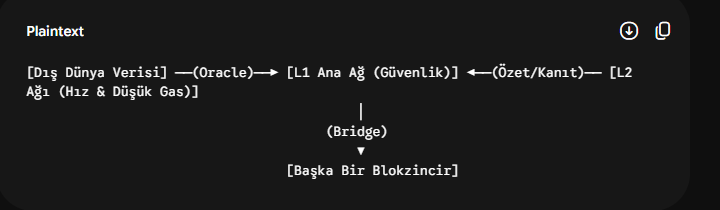
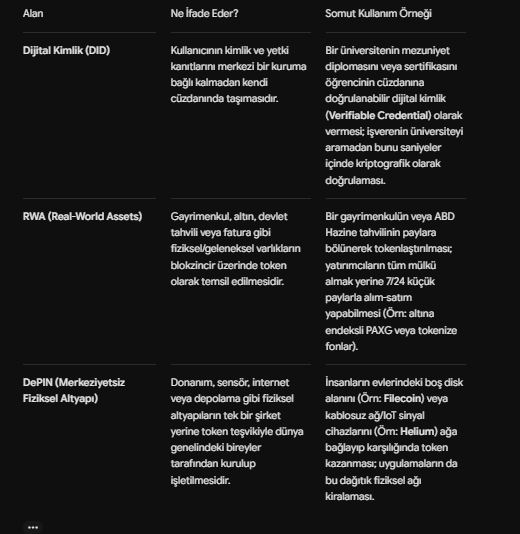

                                               İP 08: Ekosistemi Tanı
                                            
1. Temel Ekosistem Kavramları
Web3: Kullanıcıların verilerini, kimliklerini ve dijital varlıklarını merkezi teknoloji şirketlerinin (Web2) sunucuları yerine doğrudan kendi cüzdanları ve blokzincir protokolleri üzerinden kontrol edebildiği internet yaklaşımıdır. "Sadece oku ve yaz" modeline "sahip ol" katmanını ekler.

L1 / L2 (Katman 1 ve Katman 2):

L1 (Layer 1): Kendi konsensüsüne ve güvenliğine sahip temel blokzincir ağıdır (Örn: Bitcoin, Ethereum, Solana).

L2 (Layer 2): L1 ağlarındaki yavaşlık ve yüksek gas ücreti sorununu çözmek için L1'in üzerine inşa edilen ölçekleme ağlarıdır (Örn: Arbitrum, Optimism, zkSync). Binlerce işlemi kendi üzerinde ucuz ve hızlı şekilde işleyip, özetini/kanıtını güvenlik için L1'e (Ethereum'a) yazarlar.

DeFi (Merkeziyetsiz Finans): Banka veya aracı kurum olmadan; borç alma/verme, takas (DEX) ve getiri elde etme gibi finansal işlemlerin doğrudan akıllı sözleşmeler üzerinden 7/24 yürütüldüğü ekosistemdir (Örn: Uniswap, Aave).

DAO (Merkeziyetsiz Otonom Organizasyon): Geleneksel bir yönetim kurulu yerine kuralları akıllı sözleşmelere yazılmış, kararların (bütçe kullanımı, kural değişikliği) üye veya token sahiplerinin zincir üstü oylamasıyla alındığı topluluk yapısıdır.

Oracle (Kâhin): Blokzincirler dış dünyaya kapalıdır (internetten doğrudan dolar kuru veya maç skoru çekemezler). Oracle, dış dünyadaki gerçek verileri (fiyat bilgisi, hava durumu, API verisi) güvenli ve doğrulanabilir şekilde akıllı sözleşmelere taşıyan veri köprüsüdür (Örn: Chainlink).

Bridge (Köprü): Birbirinden bağımsız iki farklı blokzincir ağı arasında (örneğin Ethereum ile Arbitrum veya Solana arasında) varlık ya da mesaj aktarmayı sağlayan altyapıdır. Genellikle kaynak ağda varlığı kilitler, hedef ağda karşılığını üretir.

Zero-Knowledge Proof (ZK — Sıfır Bilgi İspatı): Bir bilginin kendisine veya detaylarına erişim vermeden, o bilginin doğruluğunu matematiksel olarak kanıtlamayı sağlayan kriptografik yöntemdir.

NOT: Ekosistemdeki en büyük hack olaylarının önemli bir kısmı doğrudan blokzincirin kendisinden değil, Bridge (köprülerdeki kilitli varlık havuzları) ve Oracle (fiyat manipülasyonu saldırıları) katmanlarından çıkar.

3. Zero-Knowledge Proof (ZK): Basit Örnek ve Gizlilik Yanılgısı
Basit Örnek: 18 Yaş Kontrolü
Bir mekana veya dijital servise girerken 18 yaşından büyük olduğunu kanıtlaman gerekiyor.

Klasik yöntem: Kimliğini gösterirsin. Karşı taraf sadece yaşını değil; T.C. kimlik numaranı, tam doğum tarihini, adını, soyadını ve fotoğrafını da görür (gereksiz veri ifşası).

ZK yöntemi:

Kanıtlanan bilgi: "Bu kişi 18 yaşından büyüktür" önermesinin doğruluğu.

Saklanan bilgi: Doğum tarihi, T.C. kimlik numarası, ad-soyad ve diğer tüm kişisel veriler.

Karşı taraf, elindeki kriptografik kanıtı doğrulayarak senin gerçekten 18 yaş üstü olduğundan %100 emin olur ama kaç yaşında olduğunu veya kim olduğunu öğrenemez.

"ZK Kullanılıyor" Demek Bütün İşlemler Gizli Demek midir?
Hayır. Bu, ekosistemde en sık yapılan kavram hatalarından biridir. ZK teknolojisi iki farklı amaçla kullanılır:

Gizlilik (Privacy) amaçlı ZK: Gönderen, alıcı ve miktar gibi işlem detaylarını gizlemek için kullanılır (Örn: Zcash veya gizlilik protokolleri).

Ölçekleme / Sıkıştırma (Validity Proof) amaçlı ZK: ZK-Rollup adı verilen L2 ağları (zkSync, Starknet, Scroll vb.) ZK'yı işlemleri gizlemek için değil, binlerce işlemin kurallara uygun yapıldığını tek bir küçük matematiksel kanıta sıkıştırıp Ethereum L1'e hızlı ve ucuz onaylatmak için kullanır. Bu ağlarda kimin kime ne kadar gönderdiği block explorer'da herkese açık görünmeye devam eder.

