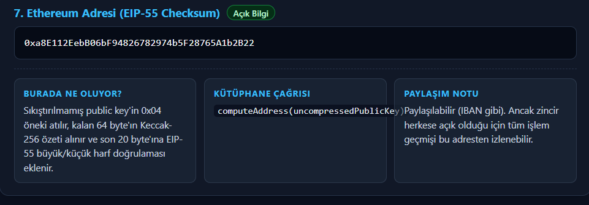

# İP 13: MetaMask ile Karşılaştır ve Checksum Deneyi

## 1. MetaMask'a İçe Aktarma (İzole Profil)
- İP 12'de kendi yerel cüzdan oluşturucumla ürettiğim yalnızca eğitim amaçlı 12 kelimeyi, kişisel cüzdanlara dokunmadan ayrı bir tarayıcı profilindeki MetaMask uzantısına **"Mevcut bir cüzdanı içe aktar"** seçeneğiyle aktardım.

## 2. Adres Karşılaştırması ve Doğrulama
- **Kullanılan standart parametreler:**
  - Türetme yolu (Derivation Path): `m/44'/60'/0'/0/0`
  - Hesap indeksi: `0`
  - Ek BIP39 passphrase: Boş (`""`)
- **Sonuç:** Kendi uygulamamın 7. aşamasında ürettiği Ethereum adresi ile MetaMask'in **Account 1** altında gösterdiği 20 baytlık (40 hex karakterlik) adres birebir eşleşti.

## 3. BIP39 Checksum Deneyi
- **Yapılan test:** Geçerli bir 12 kelimelik test mnemonic'inin bir kelimesi, BIP39 İngilizce kelime listesinden başka bir geçerli kelimeyle (`about` -> `zoo`) değiştirilerek `ethers` (`Mnemonic.isValidMnemonic`) ile doğrulandı.
- **Sonuç:** `false` (Doğrulama reddedildi).
- **Neden tek kelime değişikliği her zaman `false` vermez?**
  - 12 kelimelik BIP39 mnemonic'inde entropi **128 bit**, SHA-256'dan eklenen checksum ise yalnızca **4 bit**tir ($2^4 = 16$ olası değer).
  - Bir kelime geçerli listeden rastgele başka bir kelimeyle değiştirildiğinde, **15/16 (%93,75)** ihtimalle checksum uyuşmaz ve ifade geçersiz sayılır.
  - Ancak **1/16 (%6,25)** ihtimalle yeni bit diziliminin SHA-256 özeti şans eseri aynı 4 bitlik checksum'ı üretir; bu durumda doğrulama `true` döner fakat bambaşka bir seed ve cüzdan adresi oluşur.

## 4. Aktif Eğitim Hesabı
- Checksum deneyinde kullanılan değiştirilmiş mnemonic yalnızca test içindir ve asıl eğitim hesabı yerine kullanılmamıştır. Sonraki görevlerde MetaMask ile eşleşmesi doğrulanan ilk eğitim hesabı kullanılacaktır.

## Benim Yorumum: Geçerli mnemonic ile güvenli biçimde üretilmiş mnemonic aynı iddia mıdır?
Hayır, aynı şey değildir. **Geçerli mnemonic**, yalnızca BIP39 kelime listesine ve 4 bitlik checksum kuralına matematiksel olarak uyan herhangi bir 12 kelimelik dizidir; örneğin tüm entropisi sıfırlardan oluşan `abandon abandon ... about` ifadesi tamamen geçerlidir ama herkes tarafından bilindiği için sıfır güvenlik sunar. **Güvenli biçimde üretilmiş mnemonic** ise geçerli olmasının yanında tahmin edilemez, yüksek entropili bir CSPRNG kaynağıyla (`window.crypto.getRandomValues` gibi) çevrimdışı/izole üretilmiş ve kimseyle paylaşılmamış olmalıdır.

