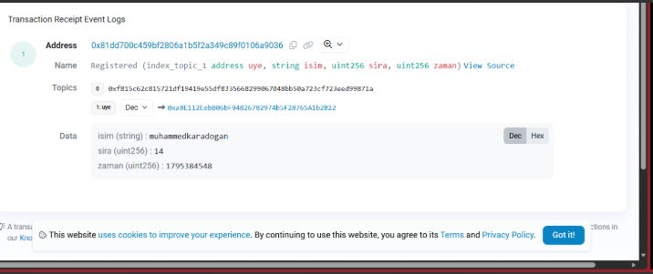
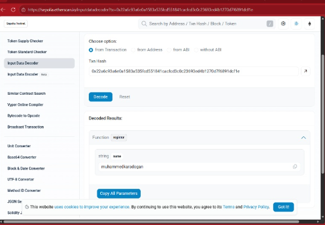

# İP-17: Explorer ile Kaydı Doğrula

## 1. Başarılı İşlemin Etherscan Alanları
- **İşlem Kimliği (Tx Hash):** `0x22a6c93a6e0a1583a535fcd551841cacfcd3c0c23693ed4b1270d7f6891dcf1e`
- **Etherscan Linki:** https://sepolia.etherscan.io/tx/0x22a6c93a6e0a1583a535fcd551841cacfcd3c0c23693ed4b1270d7f6891dcf1e

| Alan | Değer | Açıklama |
| :--- | :--- | :--- |
| **From** | `0xa8E112EebB06bF94826782974b5F28765A1b2B22` | İşlemi başlatan, imzalayan ve gas ücretini ödeyen kendi Sepolia cüzdan adresim. |
| **To** | `0x81Dd700C459BF2806A1B5F2a349c89f0106A9036` | Etkileşime girilen takımın `QuantumKayit` akıllı sözleşme adresi. |
| **Status** | `Success` (Onaylandı) | İşlemin EVM tarafından hata almadan çalıştırıldığını ve bloğa başarıyla işlendiğini gösterir. |
| **Gas Used / Ücret** | `583,651` (Limit: `589,450` – %99.02) | İşlemin zincirde çalışması için harcanan hesaplama miktarı. Base Fee `0.000000014 Gwei`, Max Priority Fee `1.5 Gwei` üzerinden ücretlendirilmiştir. |
| **Nonce** | `2` | Bu cüzdandan Sepolia ağında gönderilen işlemlerin sıra numarasıdır (0'dan başlar, yani bu 3. işlemdir). Aynı işlemin tekrar oynatılmasını (replay) engeller. |
| **Input Data** | `MethodID: 0xf2c298be` (`register(string name)`) | Sözleşmede hangi fonksiyonun hangi parametreyle çağrıldığını tutan ham (hex) veridir. |

## 2. Decode Input Data Doğrulaması
`Input Data` alanı çözümlendiğinde (Decode Input Data), çağrılan fonksiyonun `register` ve gönderilen `string name` parametresinin **`muhammedkaradogan`** olduğu doğrulandı.

*(Ekran görüntüsü: `decode-input-data.png`)*

## 3. Logs (Registered Event) Doğrulaması
İşlemin **Logs** sekmesinde sözleşmenin yayınladığı `Registered` event'i incelendi ve aşağıdaki değerler doğrulandı:
- **uye (indexed address):** `0xa8E112EebB06bF94826782974b5F28765A1b2B22`
- **isim (string):** `muhammedkaradogan`
- **sira (uint256):** `14`
- **zaman (uint256):** `1795384548`

*(Ekran görüntüsü: `logs-registered-event.png`)*

## 4. Read Contract (State) Doğrulaması
Sözleşmenin **Contract -> Read Contract** sekmesinden mevcut zincir durumu (state) sorgulandı:
- **`kayitliMi(0xa8E112EebB06bF94826782974b5F28765A1b2B22)`:** `true` döndü. Bu fonksiyon yalnızca cüzdanın kayıtlı olup olmadığını (`true`/`false`) söyler, kayıtlı ismi göstermez.
- **`tumKayitlar()`:** Dönen listede **14. sırada** `uye: 0xa8E112EebB06bF94826782974b5F28765A1b2B22`, `isim: muhammedkaradogan`, `sira: 14`, `zaman: 1795384548` kaydının bulunduğu ve gönderilen isimle birebir eşleştiği doğrulandı.

## 5. İşlem Akış Şeması (İP-07 Güncellemesi)
```text
[1. Cüzdan Onayı]
Remix'te register("muhammedkaradogan") çağrıldı -> MetaMask imzası ve gas onayı verildi.
       │
       ▼
[2. Gönderim (Broadcast)]
İşlem Sepolia ağına iletildi.
Tx Hash: 0x22a6c93a6e0a1583a535fcd551841cacfcd3c0c23693ed4b1270d7f6891dcf1e
       │
       ▼
[3. Bekleme (Mempool -> Blok)]
İşlem ağda doğrulandı ve bloğa dahil edildi (Nonce: 2, Position in Block: 10).
       │
       ▼
[4. Sonuç Kontrolü]
Etherscan'de Status: Success, Decode Input Data, Logs (Registered event) ve
Read Contract (kayitliMi: true, tumKayitlar: sıra 14) üzerinden doğrulandı.


