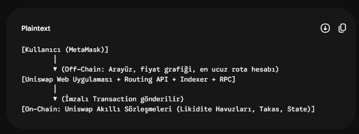
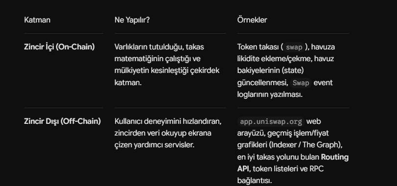

İP 09: Gerçek Bir Blokzincir Projesini İncele (Uniswap)
Amaç: Öğrenilen blokzincir kavramlarını gerçek hayatta aktif kullanılan bir sistemle ilişkilendirmek.

1. Seçilen Proje ve Resmî Kaynaklar
Proje Adı: Uniswap (Merkeziyetsiz Borsa / DEX — Ethereum ve L2 ağları üzerinde çalışır)

Resmî Web Sitesi: [https://uniswap.org](https://uniswap.org)

Resmî Dokümantasyon: [https://docs.uniswap.org](https://docs.uniswap.org)

Kaynak Kod (GitHub): [https://github.com/Uniswap](https://github.com/Uniswap)

2. Hangi Problemi, Kimler İçin Çözer? (Zincir İçi vs. Zincir Dışı)
Çözdüğü Problem ve Hedef Kitle
Geleneksel veya merkezi kripto borsalarında (Binance, Coinbase vb.) iki varlığı takas etmek için paranı önce borsanın kontrolündeki hesaba yatırman, kimlik onayı (KYC) vermen ve alıcı-satıcı eşleştirmesi için borsanın sunucularına güvenmen gerekir. Borsa iflas ederse, hacklenirse veya hesabını dondurursa varlıklarına erişemezsin.

Uniswap, bu aracı kurum ihtiyacını ortadan kaldırır. Emir defteri (order book) yerine AMM (Automated Market Maker — Otomatik Piyasa Yapıcı) adı verilen likidite havuzlarıyla çalışır.

Normal Kullanıcılar (Trader'lar): Cüzdanındaki varlıkları kimseye emanet etmeden, 7/24 doğrudan akıllı sözleşme üzerinden bir token'ı diğerine çevirmek isteyenler.

Likidite Sağlayıcılar (LP): Elindeki token çiftlerini (örneğin ETH + USDC) havuza kilitleyip her takastan işlem komisyonu kazanmak isteyenler.

Geliştiriciler / Yeni Projeler: Merkezi borsalara yüksek listeleme ücreti ödemeden veya izin almadan yeni bir ERC-20 token için anında piyasa oluşturmak isteyenler.

Zincir İçi (On-Chain) ve Zincir Dışı (Off-Chain) Ayrımı
Uniswap tek bir yapı gibi görünse de arka planda iki ayrı katmandan oluşur:

3. Neden Blokzincir Kullanıyor? Normal Veritabanıyla Yapılsaydı Ne Değişirdi?
Uniswap'ın yaptığı işin aynısını (kullanıcı bakiyelerini tutup takas etmek) klasik bir SQL veritabanı + backend API ile çok daha hızlı ve sıfır gas ücretiyle yapabilirsin — zaten merkezi borsalar (Binance vb.) tam olarak bunu yapıyor.

Eğer Uniswap normal bir veritabanıyla yapılsaydı şu temel özellikler kaybolurdu:

Saklama (Custody) Zorunluluğu: Veritabanında işlem yapabilmek için kullanıcıların paralarını şirketin kontrolündeki hesaplara aktarması gerekirdi. Blokzincirde ise takas anına kadar varlıklar kullanıcının kendi cüzdanında (private key kontrolünde) kalır.

İzin ve Sansür Riski: Normal veritabanında admin istediği hesabı dondurabilir, belirli ülkeleri engelleyebilir veya hangi token'ın listeleneceğine tek başına karar verir. Uniswap'ın akıllı sözleşmeleri permissionless (izinsiz) çalışır; sözleşme adresi ve ABI'si olan herkes arayüz kapansa bile doğrudan zincir üzerinden takas yapabilir.

Şeffaflık ve Rezerv Kanıtı: Merkezi bir borsanın veritabanında "kasada 100 milyon dolar var" yazsa bile bunun gerçek olup olmadığını dışarıdan göremezsin (FTX çöküşünde olduğu gibi). Uniswap'ta tüm likidite havuzları ve takas kuralları zincirde herkese açıktır ve anlık doğrulanabilir.

Tekil Hata Noktası (SPOF): Şirket sunucuları kapanırsa veritabanı durur; Uniswap çekirdek sözleşmeleri ise Ethereum çalıştığı sürece 7/24 çalışmaya devam eder.

4. Kullanıcı Hangi Konularda Yöneticiye, İşletmeciye veya Veri Sağlayıcısına Güvenir?
"Merkeziyetsiz" olması, sistemde sıfır güven olduğu anlamına gelmez. Kullanıcı protokolün çekirdeğine güvenmese bile çevresindeki katmanlara belirli ölçüde güvenir:

Arayüz İşletmecisine (Uniswap Labs — app.uniswap.org): Web sitesinin ekranda gösterdiği işlem verisinin gerçekten imzalanan veriyle aynı olduğuna, arayüzün zararlı bir sözleşmeye yönlendirmediğine güvenir. Ayrıca Uniswap Labs yasal baskılarla bazı adresleri veya tokenları kendi web arayüzünden gizleyebilir/engelleyebilir (protokolü durduramasa da erişimi zorlaştırabilir).

RPC ve Veri/Rota Sağlayıcılarına: Cüzdanın bağlandığı RPC sağlayıcısının (Infura, Alchemy vb.) doğru bakiye ve havuz verisi döndürdüğüne, gönderilen işlemi sansürlemeden ağa ilettiğine; Routing API ve Indexer'ların ise fiyatları manipüle etmeden en verimli rotayı hesapladığına güvenir.

Protokol Yönetişimine (Uniswap DAO): Çekirdek sözleşmelerin mantığı değiştirilemese de, UNI token sahiplerinin oylamasıyla açılıp kapatılabilen protokol komisyonu (fee switch) veya yeni sürüm dağıtımları konusunda DAO kararlarına güvenir.

Token Listesi Sağlayıcılarına: Herkes aynı isimle sahte ERC-20 token basabildiği için, arayüzde seçilen "USDC" veya "WBTC" etiketinin gerçekten orijinal sözleşme adresine karşılık geldiğine güvenir.

NOT:Bir DeFi projesinde akıllı sözleşme %100 güvenli olsa bile, web sitesinin DNS'i veya frontend kodu ele geçirilirse (frontend hijack) saldırgan kullanıcıya meşru arayüz üstünden zararlı bir approve / transfer işlemi imzalatabilir.

5. Benim Yorumum: Bir Güçlü Tarafı ve Bir Sınırlaması
Güçlü Tarafı (Aracısız ve Değiştirilemez Çekirdek): Uniswap'ın en güçlü yanı, çekirdek takas sözleşmelerinin immutable (değiştirilemez) ve izinsiz olmasıdır. Şirket yarın kapansa veya web sitesi erişime engellense bile, Ethereum üzerinde duran akıllı sözleşmeler çalışmaya devam eder ve kullanıcılar kendi cüzdanlarından doğrudan (RPC/Explorer üzerinden) fonlarını çekebilir veya takas yapabilir. Bu, geleneksel finansal sistemlerde bulunmayan çok güçlü bir erişilebilirlik ve mülkiyet garantisidir.

Sınırlaması (Kullanıcı Hata Maliyeti, Gas ve MEV Riski): Sistem tamamen izinsiz ve geri döndürülemez olduğu için güvenlik yükünün neredeyse tamamı son kullanıcının sırtındadır. Yanlışlıkla sahte bir token sözleşmesiyle takas yapmak, yüksek kayma (slippage) yüzünden MEV / Sandwich saldırısına (botların senin işleminin önüne ve arkasına işlem koyup kâr etmesi) uğramak veya yoğun zamanlarda yüksek gas ücreti ödemek günlük kullanıcı için ciddi bir engeldir. Hata yapıldığında işlemi iptal edecek bir müşteri hizmetleri yoktur.

