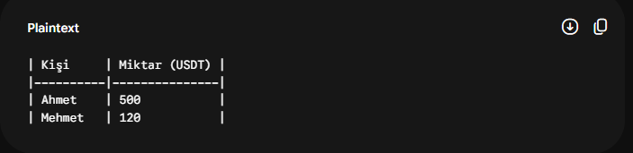
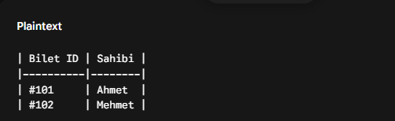
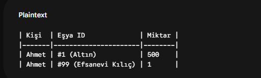

"Değiştirilebilir" kelimesi Türkçe'de berbat bir çeviri, kafa karıştırması çok normal. İnsanın aklına direkt "veriyi sonradan editleyebiliyor muyuz?" gibi bir şey geliyor, onunla hiçbir alakası yok.

O kelimenin gerçek anlamı şu: "Hangisi olduğu fark etmez, birbirinin yerine geçer."

İki günlük örnekle olay 10 saniyede çözülür:

Birbirinin yerine geçen (ERC-20): Arkadaşından 200 TL borç aldın. Yarın geri öderken ona dün verdiği birebir aynı seri numaralı 200 TL'lik banknotu vermek zorunda mısın? Hayır. Herhangi bir 200 TL versen borç biter. Çünkü bütün 200 TL'ler birbirinin aynısıdır.

Birbirinin yerine GEÇMEYEN (ERC-721 / NFT): Arkadaşından bilgisayarını (veya arabasını) ödünç aldın. Yarın geri verirken "Al kanka başka bir laptop getirdim, ne fark eder" diyemezsin. O kendi bilgisayarını ister. Çünkü her biri tektir, eşi yoktur.

Peki konunun tamamı (ERC olayı) ne?
Önce şunu oturtalım: Token dediğin şey aslında Ethereum ağının üzerinde duran ufacık bir veritabanı tablosudur (akıllı sözleşme).

ERC-20, ERC-721 ve ERC-1155 dediğimiz şeyler de sadece bu tablonun 3 farklı sütun tasarımıdır:

1. ERC-20 (Sadece bakiye tutan tablo — Para için)
Hangi paranın hangi seri numaralı olduğu umrunda değildir, sadece kimin kaç tane olduğu yazar:

Ahmet, Mehmet'e 50 tane gönderince Ahmet'inki 450, Mehmet'inki 170 olur. Hepsi aynı olduğu için tek tek numaralandırmaya gerek yoktur.

2. ERC-721 (Her şeye tek tek ID veren tablo — Bilet, Sertifika, Tapu için)
Burada miktar değil, hangi ID'li eşyanın kimde olduğu yazar:

Ahmet'in #101 numaralı bileti VIP, Mehmet'in #102 numaralı bileti arka sıra olabilir. Bunları birbirinin yerine koyamazsın.

3. ERC-1155 (İkisini tek tabloda birleştiren tasarım — Oyunlar için)
Bir oyunda hem 500 tane sıradan altının hem de 1 tane tek ve özel kılıcın varsa, iki ayrı tablo açmak yerine hepsini tek tabloya koyarsın:

