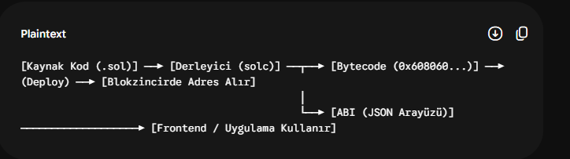
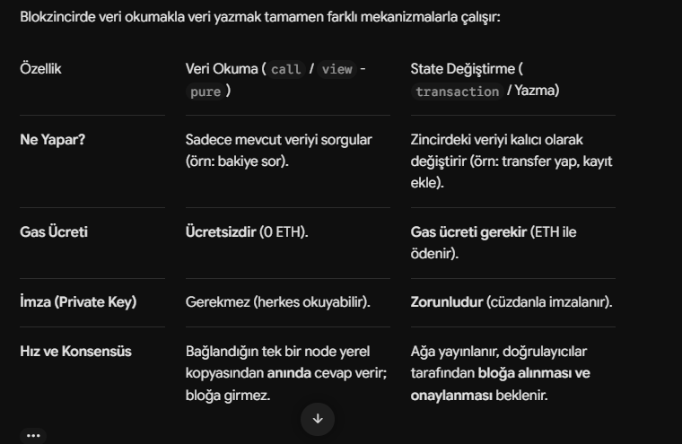

İP 05: Akıllı Sözleşme ve ABI
Amaç: Kodun zincirde çalışmasını ve çağrılmasını anlamak.

1. Akıllı Sözleşme, EVM ve State Nedir?
Akıllı Sözleşme (Smart Contract): Blokzincir üzerinde yaşayan, kendi adresi (0x...) ve kalıcı veri alanı bulunan, önceden yazılmış kuralları aracıya gerek kalmadan otomatik çalıştıran programlardır (Ethereum'da genellikle Solidity ile yazılır).

EVM (Ethereum Virtual Machine): Akıllı sözleşmelerin ağdaki tüm düğümlerde (node) aynı anda, izole (sandbox) ve deterministik (aynı girdiye her makinede birebir aynı çıktıyı verecek şekilde) çalışmasını sağlayan sanal makinedir.

State (Durum): Sözleşmenin blokzincirde kalıcı olarak sakladığı tüm değişkenler ve verilerdir (örneğin kimin kaç bakiyesi olduğu, etkinliğe kimlerin kayıt olduğu, mevcut sayaç değeri). Bir veritabanındaki güncel tablo hali gibi düşünebilirsin; yeni bir yazma işlemi geldikçe state güncellenir.

2. Kaynak Kod, Derleme, Bytecode ve Deploy İlişkisi
EVM, insanın yazdığı Solidity kodunu doğrudan okuyamaz; makine seviyesinde çalıştırılabilir koda ihtiyaç duyar. Süreç klasik yazılım derleme hattıyla birebir aynıdır:

3. ABI Ne İşe Yarar? Ne Zaman Elde Edilir? Adres Dışında Neye İhtiyaç Vardır?
ABI (Application Binary Interface): Sözleşmenin dış dünyayla nasıl konuşacağını tarif eden JSON formatındaki kullanım kılavuzudur (bir Web API'nin Swagger/OpenAPI dokümantasyonu veya koddaki Interface gibi).

Ne işe yarar? Zincirde sadece ham Bytecode (0 ve 1'ler / hex kodları) durur. Senin yazdığın web sitesi (React/JS) veya bir Python/C# istemcisi sözleşmedeki kayitOl(string isim) fonksiyonunu çağırabilmek için bu fonksiyonun adını, hangi tipte parametre aldığını ve ne döndüreceğini bilmek zorundadır. ABI, uygulamanın gönderdiği insan okunur isteği EVM'nin anlayacağı hex verisine çevirir ve dönen hex cevabı tekrar okunabilir veriye dönüştürür.

Ne zaman elde edilir? Sözleşme derlendiği (compile) anda derleyici tarafından otomatik üretilir (deploy etmeden önce bile elindedir).

Bir sözleşmeyle etkileşim için adresi dışında hangi arayüz bilgilerine ihtiyaç duyarsın?

Fonksiyon imzaları: Fonksiyonun adı, aldığı parametrelerin sırası ve veri tipleri (uint256, address, string vb.) ile dönüş tipleri.

Durum değiştirme türü (State Mutability): Fonksiyonun sadece okuma mı (view / pure), yazma mı yoksa ETH kabul eden (payable) bir fonksiyon mu olduğu.

Event (Olay) ve Custom Error tanımları: Sözleşmenin yayınladığı log kayıtlarını dinleyebilmek veya dönen özel hata kodlarını anlamlandırabilmek için gereken şemalar. (Bunların tamamı zaten ABI dosyasının içinde yer alır; ayrıca ağı bilmek için Chain ID / RPC URL gerekir.)

4. Veri Okumak (Call) ile State Değiştiren İşlem (Transaction) Farkı
Blokzincirde veri okumakla veri yazmak tamamen farklı mekanizmalarla çalışır:

5. Kaynak Kodu Verify Etmek Neyi Doğrular? Güvenlik Denetimiyle Aynı Şey midir?
Verify (Doğrulama) Neyi Doğrular? Etherscan gibi bir blok gezginine (explorer) sözleşmenin Solidity kaynak kodunu, kullandığın derleyici sürümünü ve ayarlarını yüklersin. Gezgin bu kodu kendi sunucusunda tekrar derler ve çıkan bytecode ile zincirde o adreste duran bytecode'u birebir karşılaştırır. Eşleşirse "Verified" işareti verir. Yani verify işlemi sadece şunu kanıtlar: "Zincirde çalışan bu karmaşık bytecode, gerçekten burada paylaşılan bu kaynak kodundan üretilmiştir." (Ayrıca Etherscan üzerinden doğrudan Read/Write butonlarının açılmasını sağlar.)

Güvenlik Denetimi (Audit) ile Aynı Şey midir? Kesinlikle hayır.

Verify edilmiş bir sözleşmenin içinde ağır güvenlik açıkları (reentrancy, yetki kontrolü eksikliği) veya kullanıcıların parasını çalan kasıtlı bir arka kapı (backdoor / rug pull) bulunabilir.

Verify sadece kodun şeffaf ve gerçek olduğunu doğrular; kodun güvenli olduğunu doğrulamaz. Güvenlik denetimi (audit), uzmanların o açık kaynak kodu satır satır inceleyip zafiyet araması sürecidir.

NOT: Saldırganlar sahte token veya dolandırıcılık sözleşmelerini de sıkça verify ederler çünkü kullanıcılar yeşil "Verified" tikini görünce sözleşmenin güvenli olduğunu sanma eğilimindedir. Yeşil tik "bu kod temiz" değil, "bu kodun içi açıkça okunabiliyor" demektir.

Yorumum: Aynı Kod İki Farklı Adrese Yayınlanınca Kayıtları Neden Ayrı Olabilir?
Bu durum nesne yönelimli programlamadaki Sınıf (Class) ve Nesne (Instance) ilişkisine benzer. Yazdığın Solidity kaynak kodu bir şablondur (Class). Bu kodu blokzincire her deploy ettiğinde EVM, o şablondan tamamen bağımsız yeni bir örnek (Instance) oluşturur, ona farklı bir sözleşme adresi verir ve o adrese ait ayrı bir depolama alanı (storage/state) tahsis eder.

Dolayısıyla aynı kaynak kodunu iki farklı adrese yayınladığında ikisinin çalışma kuralları birebir aynı olsa da tuttukları veriler birbirinden tamamen izoledir. İlk adrese eklenen bir kayıt veya değiştirilen bir değişken, ikinci adresteki sözleşmenin state'ini hiçbir şekilde etkilemez.