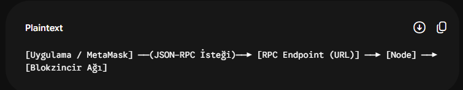
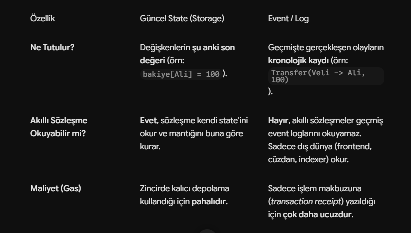
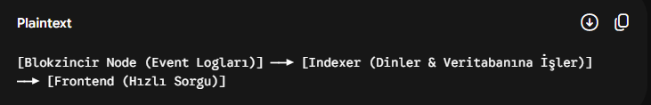

                               İP 06: RPC, Explorer ve Event

1. RPC ve RPC Endpoint Nedir? Node ve RPC Sağlayıcısı ile İlişkisi
Bir web uygulaması (frontend), mobil uygulama veya cüzdan (MetaMask), blokzincir verisini doğrudan havadan okuyamaz; ağa bağlı bir node ile konuşmak zorundadır.

RPC (Remote Procedure Call — Uzaktan Yordam Çağrısı): Bir uygulamanın, uzaktaki bir düğümün (node) üzerindeki fonksiyonları sanki kendi bilgisayarındaymış gibi çağırmasını sağlayan iletişim protokolüdür (Ethereum'da genellikle HTTP/WebSocket üzerinden JSON-RPC kullanılır; örn: eth_getBalance, eth_sendRawTransaction).

RPC Endpoint: Bu istekleri gönderebildiğin ağ adresi (URL)'dir (örneğin [https://sepolia.infura.io/v3/](https://sepolia.infura.io/v3/)<API_KEY>). Bir REST API'nin base URL'i gibi düşünebilirsin.

Node ve RPC Hizmet Sağlayıcısı İlişkisi:

İstersen kendi bilgisayarında/sunucunda bir Ethereum node çalıştırıp kendi yerel RPC endpoint'ini (http://localhost:8545) açabilirsin. Ancak tam bir node çalıştırmak yüksek disk, bant genişliği ve bakım maliyeti ister.

RPC Hizmet Sağlayıcıları (Alchemy, Infura, QuickNode, Ankr gibi), arka planda senin yerine çok sayıda güncel ve yüksek erişilebilirlikli node çalıştıran ve sana hazır bir RPC Endpoint URL'i kiralayan altyapı servisleridir.

2. Block Explorer Nedir? Explorer veya RPC Kapanırsa Ağ Durur mu?
Block Explorer (Blok Gezgini): Blokzincirdeki ham verileri (bloklar, işlemler, cüzdan bakiyeleri, akıllı sözleşme kodları, event logları) node'lardan çekip veritabanına işleyen ve insanların tarayıcıdan kolayca okuyup arayabileceği bir web arayüzü sunan araçtır (Ethereum için Etherscan, test ağı için Sepolia Etherscan).

Explorer'ın veya bir RPC adresinin kapanması ağın durduğunu gösterir mi? Hayır, kesinlikle göstermez.

Explorer sadece zinciri izleyen bir vitrin / arama motorudur. Etherscan çökerse sen işlemleri o web sitesinden göremezsin ama blokzincir arka planda blok üretmeye devam eder.

Tek bir RPC sağlayıcısının (örneğin Infura'nın) çökmesi de sadece o endpoint'i kullanan uygulamaların veya cüzdanların ağla bağlantısını geçici olarak keser. Başka bir RPC sağlayıcısına (örneğin Alchemy) veya kendi node'una geçtiğin an ağın sorunsuz çalıştığını görürsün.

Not: Merkeziyetsiz bir ağda herkes aynı tek RPC sağlayıcısına bağımlıysa burada bir merkezileşme darboğazı (SPOF) oluşur. Ayrıca kötü niyetli veya ele geçirilmiş bir RPC endpoint'i sana yanlış bakiye gösterebilir veya gönderdiğin işlemleri sansürleyip ağa iletmeyebilir (ama private key'in onda olmadığı için senin adına sahte işlem imzalayamaz).

3. Event / Log ile Güncel State Farkı ve Indexer'ın Görevi
Sözleşmede iki farklı veri katmanı vardır; biri "şu anki durum", diğeri *"geçmişte neler olduğunun kaydı"*dır:

Indexer Ne İşe Yarar?
Ham bir blokzincir node'u veritabanı gibi esnek sorgulara (SELECT * FROM transfers WHERE sender = '0x...' ORDER BY date DESC) uygun değildir; bir kullanıcının son 1 yıldaki tüm transferlerini doğrudan bir node'dan sormak için milyonlarca bloğu tek tek taraman gerekir.Indexer (örneğin The Graph, Envio veya özel bir backend servisi), zincirden gelen blokları ve event loglarını sürekli dinler, bunları klasik hızlı bir veritabanına (PostgreSQL gibi) düzenli şekilde kaydeder ve uygulamalara saniyeler içinde filtrelenebilir API/GraphQL sorgusu sunar.

4. Yorumum: Explorer Olmadan Bir Kaydı Kontrol Etmek İçin Hangi Yolu Araştırırdınız?
Etherscan gibi bir block explorer kapalıysa veya üçüncü parti bir web sitesine güvenmeden veriyi doğrudan doğrulamak istiyorsam, doğrudan bir RPC endpoint (veya kendi yerel node'um) üzerinden zincire sorgu atma yolunu araştırırdım.

Bunun için teknik olarak şu yöntemlerden birini kullanırdım:

Kod / Kütüphane ile doğrudan sorgu: Node.js (ethers.js / viem) veya Python (web3.py) kullanarak sözleşmenin adresi ve ABI dosyası ile RPC üzerinden doğrudan call (state okuma) veya eth_getLogs (event log tarama) isteği göndermek.

Komut satırından hızlı kontrol: curl ile doğrudan JSON-RPC isteği atmak (örn. eth_getTransactionByHash veya eth_call) ya da Foundry'nin cast aracıyla terminalden tek satırda sözleşme durumunu okumak.
